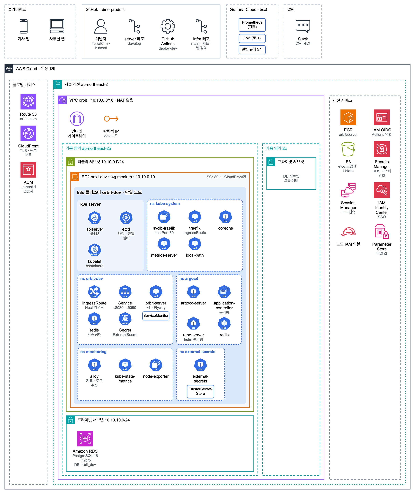
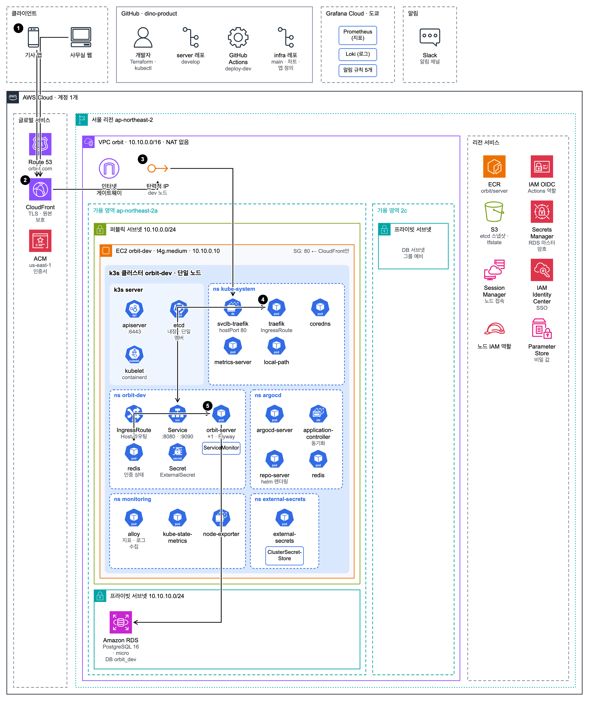
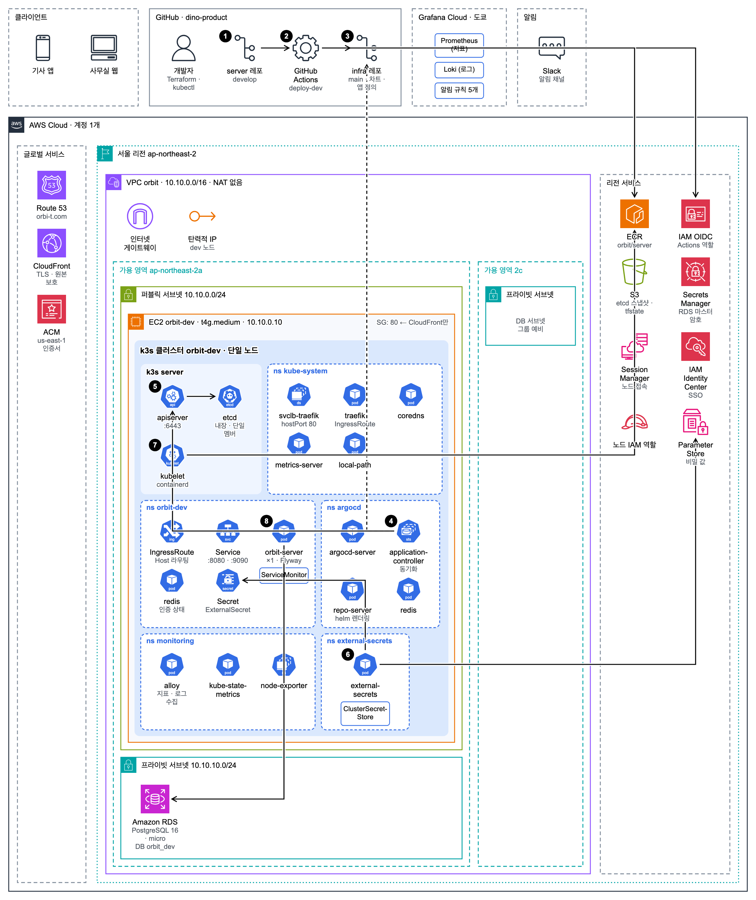
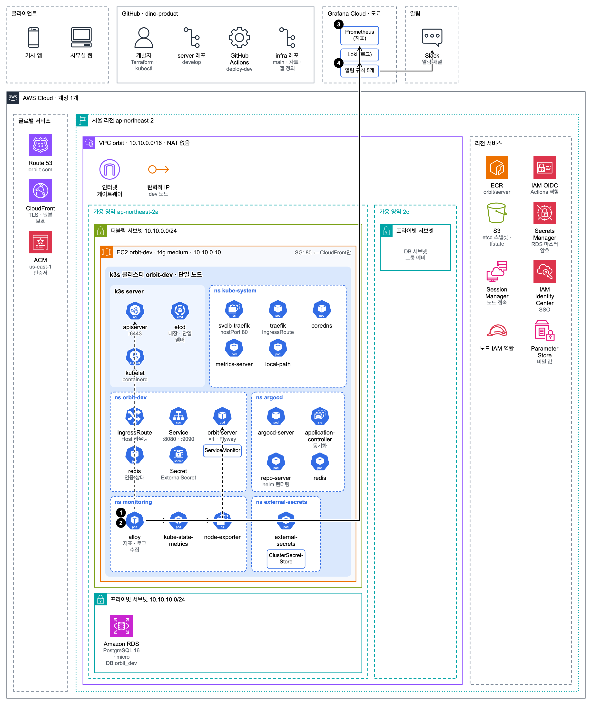

# Orbit infra

Orbit 백엔드([dino-product/server](https://github.com/dino-product/server))를 띄우는 인프라 코드. Terraform · Helm 차트 · Argo CD 앱 정의가 여기 있다.

> **EC2 한 대 위 k3s 단일 노드에 dev를 띄우고, 관측은 Grafana Cloud, 배포는 Argo CD에 맡긴다.**
>
> - **요청**: CloudFront(TLS) → 노드(Traefik) → orbit-server → RDS · Redis
> - **배포**: develop 머지 → 이미지 ECR push → 이 레포에 태그 커밋 → Argo CD 자동 동기화
> - **관측**: Alloy가 지표 · 로그를 Grafana Cloud로 보내고, 알림은 Slack으로
> - **비용**: dev 월 약 $61. prod는 아직 없음

접속 방법 · 권한 · 운영 절차 · 알림 대응은 팀 내부 문서에 있다.

## 기술 스택

| 영역 | 사용 |
| --- | --- |
| 클라우드 | AWS 서울 리전: EC2 (Graviton t4g), RDS PostgreSQL 16, CloudFront, Route 53, ECR, S3, Parameter Store, IAM Identity Center |
| 오케스트레이션 | k3s (단일 노드), Helm |
| 배포 | GitHub Actions (OIDC), Argo CD (App of Apps) |
| 비밀 값 | Parameter Store + External Secrets Operator |
| 관측 | Grafana Alloy, Grafana Cloud (Prometheus · Loki · Alerting), Slack |
| IaC | Terraform (S3 state) |

## 아키텍처



흐름별 그림의 번호는 그림 아래 목록 순서다.

<details>
<summary><b>요청 흐름</b>: 앱 · 웹 → CloudFront → 노드(Traefik) → orbit-server</summary>



1. **API 도메인**: Route 53 별칭 레코드 → CloudFront
2. **CloudFront**: TLS 종료, 캐시 없음, 원본 확인용 헤더를 붙여 노드로
3. **노드 보안 그룹**: CloudFront에서 오는 요청만 받는다
4. **Traefik**: Host와 원본 헤더를 확인하고 라우팅
5. **orbit-server**: 인증 확인 → Redis → RDS

</details>

<details>
<summary><b>배포 흐름</b>: develop 머지 → 이미지 → 이 레포에 태그 커밋 → Argo CD 동기화</summary>



1. **develop 머지**: server 레포 배포 워크플로 시작
2. **빌드**: OIDC로 AWS 역할을 받아 arm64 이미지를 ECR에 커밋 SHA 태그로 push
3. **태그 커밋**: 이 레포 `charts/orbit-server/values-dev.yaml`의 `image.tag`를 바꿔 커밋
4. **Argo CD 감지**: GitHub 웹훅으로 바로 알고 차트를 렌더링 (웹훅이 실패해도 3분마다 확인)
5. **동기화**: 바뀐 Deployment를 클러스터에 적용
6. **Secret 준비**: External Secrets가 Parameter Store 값으로 Secret을 만든다
7. **이미지 받기**: kubelet이 노드 역할로 ECR에서 pull
8. **기동**: Flyway 마이그레이션 → readiness → 트래픽 수신

</details>

<details>
<summary><b>웹 배포 흐름</b>: web 레포 develop 머지 → 빌드 → S3 → CloudFront (main 은 prod)</summary>

사무실 웹(dino-product/web, Vite SPA)은 정적 파일이라 클러스터를 거치지 않는다. 환경마다 `modules/web-site` 하나: dev 는 `dev.orbi-t.com`(develop), prod 는 `orbi-t.com`(main, `www` 는 301). prod 배포는 prod API 가 뜰 때까지 web 레포 변수 `DEPLOY_PROD` 로 꺼 둔다

1. **develop 머지**: web 레포 `deploy-dev` 워크플로 시작 (main 은 `deploy-prod`)
2. **빌드**: `VITE_API_BASE_URL=https://dev-api.orbi-t.com` 으로 빌드 (API 는 교차 출처 → 서버 `CORS_ALLOWED_ORIGIN_PATTERNS` 에 웹 주소가 있다)
3. **올리기**: OIDC 역할 `gh-web-dev` 로 S3 버킷 `orbit-web-dev-<계정>` 에 동기화. `assets/` 는 1년 immutable, `index.html` 은 no-cache
4. **무효화**: CloudFront(OAC 로 버킷을 읽음) 의 `index.html` 만 무효화. 없는 경로(403/404) 는 `index.html` 로 돌려 라우터가 처리
5. **응답 헤더**: HSTS · nosniff · `X-Frame-Options: DENY` · Referrer-Policy · Permissions-Policy · CSP(스크립트는 자기 출처만, 연결은 API 와 사진 버킷만). 카카오 SDK 등 외부 스크립트는 모듈 `extra_script_src` 에 더한다

</details>

<details>
<summary><b>관측 흐름</b>: Alloy → Grafana Cloud → Slack</summary>



1. **지표 수집**: Alloy가 ServiceMonitor를 따라 60초마다 앱 · kube-state-metrics · node-exporter · cAdvisor를 긁는다
2. **로그 수집**: Kubernetes API로 Pod 로그를 읽고(kube-system · monitoring 제외), 이메일 · 전화번호 · 토큰은 보내기 전에 가린다
3. **전송**: 지표(원격 쓰기)와 로그를 Grafana Cloud로. 무료 한도 안 (약 850 시계열)
4. **알림**: 다운 · 5xx(503 제외) · p95 · 메모리 · 디스크 · Argo CD 앱 상태 · 실시간(SSE) · 포화 징후(OOM · DB 커넥션 대기 · 노드 CPU · 의도한 거절 503) 규칙 → Slack. 다운 규칙은 지표가 끊겨도 울린다 (노드가 죽으면 Alloy도 같이 죽기 때문)

</details>

## 레포 구조

```text
terraform/
  shared/          계정 공통: VPC · RDS · ECR · DNS · 인증서 · SSO · Grafana Cloud
  envs/dev/        dev 노드 · CloudFront · IAM · Argo CD 비밀 값 · 사무실 웹(web.tf)
  envs/prod/       prod 준비 코드 (노드 · 클러스터 없음) · 사무실 웹(web.tf, 배포는 꺼 둠)
  modules/node/    EC2 노드 모듈
  modules/media-bucket/  사진 버킷 모듈 (업로드 구역 · 보관 상한 · 삭제는 태그 + 수명 주기)
  modules/web-site/      사무실 웹 모듈 (비공개 S3 + OAC CloudFront + 보안 헤더 + 배포용 OIDC 역할)
charts/orbit-server/   앱 차트. values-dev.yaml의 image.tag는 server CI가 커밋한다
argocd/
  values.yaml      Argo CD 설치 값
  root-dev.yaml    루트 앱 (App of Apps)
  apps/dev/        external-secrets · monitoring-crds · platform · node-exporter · kube-state-metrics · alloy · orbit-server
platform/          클러스터 공통 구성: External Secrets · ServiceMonitor CRD(crds/) · exporter 값 · Alloy(kubelet · etcd는 Alloy가 노드를 찾아 직접 긁는다)
scripts/           k3s · Argo CD 설치, 공개 라우트 적용, 비밀 값 등록
.github/workflows/lint.yml  차트 · 스크립트 검사
```

- `main`에 올라간 `argocd/` · `charts/` · `platform/`은 Argo CD가 바로 클러스터에 반영한다
- `terraform/`은 사람이 `plan` · `apply`로 적용한다

## 설계 결정

| 영역 | 선택 | 대안과 고르지 않은 이유 |
| --- | --- | --- |
| 컴퓨팅 | EC2 한 대(t4g.medium) 위 k3s 단일 노드 | EKS (컨트롤 플레인만 월 약 $73), ECS Fargate (Kubernetes 직접 운영 학습 목표와 안 맞음), EC2 + Compose (자동 복구 · 선언적 관리 약함) |
| 진입점 | CloudFront + 탄력적 IP + Traefik | ALB (고정비 월 약 $20), 노드 직접 공개 (TLS · 엣지 보호 없음) |
| DB | RDS db.t4g.micro 한 대에 dev · prod DB를 분리 | 클러스터 안 PostgreSQL (백업 직접 운영), 환경별 RDS (비용 2배) |
| 관측 | Grafana Cloud 무료 + Alloy + exporter 2개 | 클러스터 안 Prometheus · Grafana · Loki (노드 메모리 약 1.2GiB), 모니터링 전용 노드 (월 $15), CloudWatch (수집량 과금, 월 약 $190 추정). kube-prometheus-stack 차트는 CRD 10개 · 렌더링 부담이 커서 exporter만 따로 설치 (2026-10-28) |
| 배포 | Argo CD (pull) + CI가 이 레포에 태그 커밋 | Actions → SSM → helm (클러스터가 Git과 어긋나도 모름), Argo CD Image Updater (Pod 추가, 배포 이력이 Git에 안 남음) |

관측을 Grafana Cloud로 옮기면서 노드 여유 메모리가 23%에서 47%로 늘었고, 그 여유로 Argo CD를 올렸다.

## 비용과 용량

dev 기준, 서울 리전 온디맨드 월 730시간.

| 구성 요소 | 사양 | 월 비용 |
| --- | --- | --- |
| EC2 | t4g.medium · 2 vCPU · 4GiB | $30.4 |
| EBS | gp3 40GB | $3.6 |
| 공인 IPv4 | 1개 | $3.6 |
| RDS | db.t4g.micro · gp3 20GB · 백업 7일 | $20.9 |
| 기타 | Route 53 · Secrets Manager · ECR · S3 | 약 $1.3 |
| CloudFront · Grafana Cloud | 무료 범위 | $0 |
| **합계** | | **약 $61** |

노드 메모리 (3.8GiB, 2026-10-28 실측): k3s server 약 1.3GB, 앱 약 430Mi(부하 때 768Mi 한도까지), Argo CD 약 520Mi(컨트롤러 414Mi), Alloy 약 115Mi, 나머지 시스템 Pod 약 300Mi. 여유 약 19%.

노드 예약(`scripts/install-k3s.sh` kubelet-arg): kube-reserved 1Gi + system-reserved 256Mi + 축출 기준 200Mi → Pod용 메모리 약 2.3GiB, pods cgroup 한도 약 2.5GiB. Pod 전체가 k3s · etcd 메모리를 밀어내지 못하고, 요청 합이 2.3GiB를 넘으면 스케줄되지 않는다 (prod를 같은 노드에 올릴 때 걸린다).

**앱 Pod 한도(768Mi)는 올리지 않는다.** 올리면 부하 때 노드 여유가 사라져 "Pod 재시작"이 "노드 위험"이 된다. 대신 한도 안에서 힙 비율 · 스레드 수를 조정하고(`values-dev.yaml` javaOpts), 넘치는 요청은 앱이 거절한다(server 레포).

## 보안 원칙

- 장기 액세스 키가 없다. 사람은 SSO, GitHub Actions는 OIDC, 노드는 인스턴스 역할
- 노드에 SSH를 열지 않는다. 접속은 SSM Session Manager로만
- 노드는 CloudFront를 거친 요청만 받는다. DB는 프라이빗 서브넷에 있다
- 비밀 값은 Parameter Store에만 두고, Git에는 이름만 둔다
- 이미지 태그는 커밋 SHA로 고정하고 덮어쓸 수 없다
- 사진은 클라이언트가 서명 URL로 S3에 바로 올린다. 앱 권한에 객체 삭제가 없다
